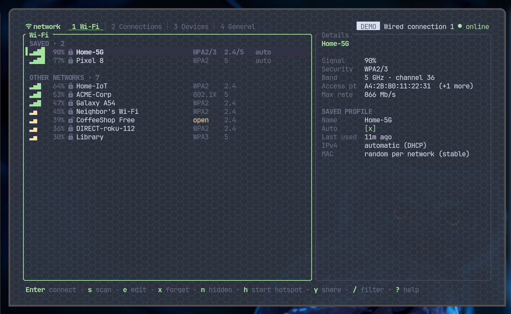

# network-tui



A network manager with a terminal UI, written in Rust with [ratatui](https://ratatui.rs). A small root daemon (`network-tui daemon`) replaces NetworkManager: it drives [iwd](https://iwd.wiki.kernel.org/) for Wi-Fi and configures everything else itself over netlink. The TUI talks to it over a Unix socket.

- Wi-Fi: scan, connect, forget, hidden networks, hotspot, QR code sharing
- Ethernet (built-in DHCP client), Wi-Fi, WireGuard, OpenVPN, VLAN, bridge and bond connections; import `.ovpn` and wg-quick files
- Full connection editor: MAC privacy, enterprise Wi-Fi, static IP, DNS, routes, with validation before saving
- Interface state, addresses, gateway, DNS and link speed
- Hostname, airplane mode, radios and connectivity check
- Built-in password agent and readable error messages
- Mouse and keyboard throughout

## Install

### Arch Linux

A PKGBUILD is in [`packaging/`](packaging/PKGBUILD):

```sh
git clone https://github.com/adelmonte/network-tui
cd network-tui/packaging
makepkg -si
```

### From source

Needs Rust 1.85+.

```sh
cargo build --release
install -Dm755 target/release/network-tui ~/.local/bin/network-tui
```

## The daemon

The daemon runs as root and needs iwd. Service files for systemd (`network-tui.service`) and init-sv (`network-tui.toml`) are in [`packaging/`](packaging/). Stop NetworkManager (or any other network manager) first: only one program should be configuring interfaces.

iwd must do its own Wi-Fi addressing; the package installs `/etc/iwd/main.conf` with:

```ini
[General]
EnableNetworkConfiguration=true

[Network]
NameResolvingService=none
```

DNS is left to whatever runs your resolver (`/etc/resolv.conf` isn't touched).

- Profiles live in `/var/lib/network-tui/profiles/` (JSON, root-only). Wi-Fi profiles are mirrored to iwd's files in `/var/lib/iwd/`, so iwd can auto-connect on its own; iwd networks without a profile are imported at startup.
- The socket is `/run/network-tui.sock`. Anyone may watch and scan; changing things needs root or membership in the `wheel` or `network` group.
- Hotspots use iwd's access point mode, with NAT through nftables. OpenVPN connections need `openvpn`.
- WEP networks aren't supported (iwd dropped WEP).

## Usage

```
network-tui [--demo] [-c|--config PATH] [--print-default-config]
network-tui daemon [--ready-fd FD] [-v]
```

| Option | |
|---|---|
| `--demo` | Run with fake networks |
| `-c`, `--config PATH` | Use a config file other than `~/.config/network-tui/config.toml` |
| `--print-default-config` | Print the default config and exit |

### Keys

| Key | Action |
|---|---|
| `1`–`4`, `Tab` | Wi-Fi / Connections / Devices / General |
| `j` / `k`, `↓` / `↑` | Move |
| `Enter` | Connect / disconnect |
| `s` | Scan |
| `e` | Edit |
| `n` | Hidden network / new connection |
| `x` | Forget / delete |
| `h` | Hotspot |
| `y` | Share as QR code |
| `/` | Filter |
| `:`, `Ctrl-P` | Command palette |
| `?` | All keys |

## Configuration

`~/.config/network-tui/config.toml` is created on first run with every option commented: icons, colors, key bindings, signal display, hotspot defaults and MAC privacy for new networks.

## License

GPL-3.0-or-later
